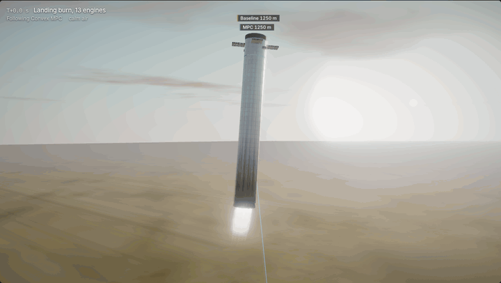
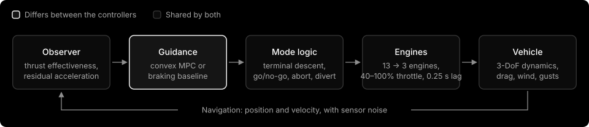

# Fuel-optimal convex guidance versus a braking heuristic for tower capture

[](https://github.com/Aidenn8/booster-catch-guidance/actions/workflows/tests.yml)
[](LICENSE)


A simulation study of the last 16 seconds of a Super Heavy booster's return to the launch
tower, where the booster has to arrive at the tower's catch arms within a metre, descending
at walking pace. Two guidance laws fly identical dispersed landing burns:

* **Convex MPC.** Every second, solve a minimum-fuel trajectory to the arms as a
  second-order cone program (lossless convexification, the method behind JPL's G-FOLD), with
  the 13 → 3 engine switch, thrust and tilt margins, an offshore commit window and a
  glide-slope cone. When the solver proves that no catch exists, abort and divert.
* **Braking baseline.** An engineered constant-deceleration braking profile with an offshore
  holding point: the kind of logic a careful engineer writes by hand.

Both share the same sensors, engines, estimator, terminal descent and abort logic, so any
difference in outcome comes from the guidance law alone.

<p align="center">
  <a href="https://aidenn8.github.io/booster-catch-guidance/"></a>
</p>

<p align="center">
  <b><a href="https://aidenn8.github.io/booster-catch-guidance/">Interactive report and 3D replay</a></b> ·
  <a href="REPORT.md">Technical report</a> ·
  <a href="EXPLAINER.md">Plain-language explainer</a> ·
  <a href="docs/REPRODUCE.md">Reproduce the results</a> ·
  <a href="docs/ARCHITECTURE.md">Code architecture</a>
</p>

> **Independent project.** Not affiliated with or endorsed by SpaceX. Every vehicle and tower
> number is a public estimate; no SpaceX data were used. The comparisons, mechanisms and
> trade-offs are the result, not the absolute percentages.

---

## Contents

- [Results](#results)
- [Key findings](#key-findings)
- [How it works](#how-it-works)
- [Verification](#verification)
- [Quick start](#quick-start)
- [Reproducing the study](#reproducing-the-study)
- [Repository layout](#repository-layout)
- [Documentation](#documentation)
- [Limitations](#limitations)
- [References](#references)
- [Citation and license](#citation-and-license)

## Results

300 dispersed landing burns per controller, the same flights for every controller: wind up to
15 m/s with gusts, drag ±20%, thrust, specific-impulse and mass errors, ignition-state errors,
navigation noise, a 0.25 s engine lag, and an engine failure at a random moment in 56 of the
300 flights. Settings were fixed beforehand on a separate 40-flight tuning set.

| | Convex MPC | MPC + approach cap | MPC + engine-out reserve | Baseline |
|---|---:|---:|---:|---:|
| **Caught, all 300 flights** (95% CI) | **86.3%** (82.0–89.8) | **86.3%** (82.0–89.8) | 50.0% (44.4–55.6) | 73.0% (67.7–77.7) |
| Caught, no engine failure | 243 / 244 | **244 / 244** | 121 / 244 | 217 / 244 |
| Saved after an engine failure | 16 / 56 | 15 / 56 | **29 / 56** | 2 / 56 |
| Pad strikes¹ | 20 | **5** | 21 | 8 |
| Median distance from the catch point | **4 cm** | **4 cm** | **4 cm** | 38 cm |
| Median propellant left at the catch | **5.2 t** | 3.7 t | 1.1 t | 3.9 t |

¹ All in flights with an engine failure, except 17 of the engine-out reserve's 21. The reserve
is only robust with more landing propellant (last row below): at the standard 45 t it either
declines catches it cannot afford or runs short of propellant in the terminal descent.

| Study | Convex MPC | Baseline |
|---|---|---|
| Capture basin: ignition point shifted ±200 m / ±300 m (143 points, calm air) | **127 caught, 0 pad strikes** | 86 caught, 25 pad strikes |
| Crosswind, 12 flights per speed | **100% up to 20 m/s** | 67% at 20 m/s |
| Engine failure at each of 33 moments (calm air) | 12 caught (engine-out reserve: **32**) | 4 caught |
| Engine-out reserve with 50 t instead of 45 t of landing propellant | **19 / 20 engine failures survived, 0 pad strikes** | – |

## Key findings

1. **The catch happens at the throttle floor.** Three Raptors at 40% throttle produce
   2.71 MN; a near-empty booster weighs about 2.75 MN. Near the arms the booster can brake
   hard but can barely speed its descent back up, so over-braking is unrecoverable. Both
   controllers therefore end with the same gentle decelerating descent from a gate 12 m above
   the catch point.
2. **Fuel-optimal guidance wins on every nominal measure.** It is caught more often, is nine
   times more precise, carries 1.3 t more propellant, catches from a far larger set of
   ignition points and tolerates stronger crosswinds.
3. **Its weak spot is the mid-burn engine failure.** Braking as late as possible saves fuel
   but leaves the booster lower and faster when an engine fails, with less room to divert:
   20 of its 56 engine-failure flights came down near the pad, against 8 for the baseline.
   A 10 m/s approach-speed cap cuts that to 5 at an unchanged catch rate, for 1.5 t of
   propellant.
4. **Engine-out tolerance costs one convex constraint and about 5 t of propellant.** A
   braking reserve that keeps the remaining engines able to stop the booster at all times
   survives 32 of 33 failure times in calm air, and with 50 t instead of 45 t of landing
   propellant survives 19 of 20 failures under full dispersions, with no pad strikes.
5. **Seven failure mechanisms** were found by tracing individual closed-loop flights (limit
   riding, actuator lag against bang-bang plans, the throttle floor, estimator/planner
   mismatch, a planner that disagreed with itself, constraints leaking between grid nodes,
   propellant for the unplanned phase). They are written up in
   [REPORT.md §6](REPORT.md#6-what-building-it-taught-me).

<table>
  <tr>
    <td width="50%"></td>
    <td width="50%"></td>
  </tr>
  <tr>
    <td><sub><b>Propellant versus robustness</b> on the tuning set. The baseline trades one for the other through its braking level; every MPC setting sits above and to the right of its curve.</sub></td>
    <td><sub><b>Crosswind tolerance.</b> Both controllers fail between 20 and 25 m/s, a limit set by the terminal descent's tilt authority rather than by either guidance law.</sub></td>
  </tr>
</table>


<sub><b>One engine fails at the time on the x-axis.</b> The tuned MPC's aborts come down on the pad when the failure is mid-burn; the engine-out reserve survives almost every failure time.</sub>


<sub><b>Capture basin.</b> The MPC re-plans from wherever the burn starts; the fixed braking profile cannot absorb a low or far-offshore start and discovers it too late to clear the pad.</sub>

## How it works

### The problem

The landing burn starts 1,250 m up and 280 m offshore with the booster falling at 270 m/s.
It lights 13 engines, switches to the 3 centre engines at 3 s, and must pass the catch point
(the booster's centre of mass at capture, 65 m above the tower base) within 1 m, descending at
under 1.5 m/s, moving sideways at under 0.5 m/s and tilted under 3°. A booster that misses
keeps flying, diverting offshore; it is a *safe miss* if it comes down more than 40 m from the
tower and a *pad strike* otherwise. Touching the tower is always a pad strike.



### Convex MPC

Following Açıkmeşe & Ploen (2007) and Açıkmeşe, Carson & Blackmore (2013), with thrust
acceleration $\mathbf u = \mathbf T/m$, slack $\sigma$ and log-mass $z = \ln m$, each re-plan
solves

$$
\begin{aligned}
\max_{\mathbf u,\sigma}\ & z(t_f) \\
\text{s.t.}\ & \dot{\mathbf r} = \mathbf v,\quad \dot{\mathbf v} = \mathbf u + \mathbf g + \hat{\mathbf a}(t),\quad \dot z = -\alpha\sigma, \\
& \lVert\mathbf u\rVert \le \sigma,\quad u_z \ge \sigma\cos\theta_{\max}(t), \\
& \mu_{\min}(t)\left[1-\delta z+\tfrac12\delta z^2\right] \le \sigma \le \mu_{\max}(t)\left[1-\delta z\right], \\
& \tan\gamma\,\lVert\mathbf r_{xy}-\mathbf r^\star_{xy}\rVert \le r_z-r^\star_z, \\
& \mathbf r(t_f)=\mathbf r_g,\quad \mathbf v(t_f)=(0,0,-v_g),\quad z(t_f)\ge\ln(m_{\text{dry}}+m_{\text{td}}),
\end{aligned}
$$

plus an offshore half-space until the commit window, on 32 nodes with a node at every rule
boundary, solved by [Clarabel](https://clarabel.org) through [CVXPY](https://www.cvxpy.org)
in 0.1–0.3 s. Here $\hat{\mathbf a}$ is drag plus the estimated disturbance, $\delta z$ is
log-mass relative to the lightest reachable mass, $\gamma = 20°$ is the glide slope and
$m_{\text{td}}$ the propellant the terminal descent needs. The relaxation is lossless
(‖**u**‖ = σ at the optimum). Propellant use rises monotonically with flight time inside the
feasible window, so the controller takes the earliest feasible $t_f$ by bisection on
feasibility. Two optional convex constraints are evaluated as variants:

* **approach cap**: close on the tower at ≤ 10 m/s inside the commit window;
* **engine-out braking reserve**: $v_z^2 \le v_g^2 + 2a_{\text{eo}}(r_z - h_g)$ in the
  3-engine phase, where $a_{\text{eo}}$ is the net deceleration with one engine fewer.

If no plan exists, the controller relaxes its margins in tiers, then admits a faster gate
arrival; if the problem is still infeasible more than 3 s before the gate, it treats that as
a certificate that the catch is lost and diverts offshore.

### Braking baseline

Vertically: the constant acceleration that lands the booster on a constant-deceleration
speed profile at the engine switch, then that profile (deceleration $a_2 = 8$ m/s²) to the
gate. Laterally: a capped braking profile towards a holding point offshore, retargeting the
catch point when the commit window opens. It rescales its braking after an engine failure
and aborts when the braking it needs exceeds 95% of what the engines can give.

### Shared stack

A thrust model (nominal limits, 0.25 s lag) and mass estimate; an observer that explains
unexplained acceleration as a thrust-effectiveness factor along the thrust and a residual
across it (mostly wind); the terminal descent from the gate, entered one lag early; a go/no-go
check at the gate, a tower keep-out monitor, and an offshore divert after any abort.

Full detail: [REPORT.md](REPORT.md) (method and results) and
[docs/ARCHITECTURE.md](docs/ARCHITECTURE.md) (how the code is organised).

## Verification

| Check | Result |
|---|---|
| Lossless gap on the nominal plan | 1.4 × 10⁻⁷ (relative) |
| Planned thrust inside the true 40–100% range | every interval |
| Vertical descent vs. an independent bang-bang shooting solution | 0.03% in propellant |
| SciPy SLSQP on the original **non-convex** problem, free flight time, three starts | all converge to within 0.02% of the convex solution |
| Plan replayed open loop in the simulator (14 s from 270 m/s) | 4.7 m, 0.40 m/s, 40 kg |
| RK4 integrator vs. the exact rocket-equation solution | < 1 mm, < 1 mm/s |

These are asserted by the test suite (`tests/`) and printed by `scripts/validate_guidance.py`.

## Quick start

```bash
git clone https://github.com/Aidenn8/booster-catch-guidance.git
cd booster-catch-guidance
python -m venv .venv && source .venv/bin/activate      # Python 3.11+
pip install -r requirements.txt
python -m pytest tests/ -q                             # 14 tests, one to two minutes
```

Fly one landing burn:

```python
from boostercatch import controllers as C, sim
from boostercatch.vehicle import NOMINAL, SUPER_HEAVY, TOWER

res = sim.simulate(C.ConvexMPC(), SUPER_HEAVY, TOWER, NOMINAL)
print(res.reason, res.capture)
# caught {'lateral_error': 0.008, 'vz': -0.989, 'vh': 0.006, 'tilt_deg': 0.017,
#         'propellant_left': 5477.9, 'time': 17.06}
```

Fly it through wind, model errors and an engine failure, with any controller variant:

```python
disp = sim.Dispersion(wind_mean=(8.0, 0.0), gust_sigma=1.7, cd_scale=1.1, thrust_bias=-0.01,
                      engine_out_time=12.0, nav_sigma_r=0.3, nav_sigma_v=0.1, seed=1)
for ctl in (C.ConvexMPC(), C.ConvexMPC(approach_cap=True), C.ConvexMPC(eo_reserve=True), C.Baseline()):
    res = sim.simulate(ctl, SUPER_HEAVY, TOWER, NOMINAL, disp)
    print(type(ctl).__name__, res.caught, res.reason, "pad safe" if res.pad_safe else "PAD STRIKE")
```

`res` also holds the full time history (`t`, `r`, `v`, `m`, `thrust`, `n_engines`); see
[docs/ARCHITECTURE.md](docs/ARCHITECTURE.md#simpy) for every field. The MPC takes roughly
10–20 s per flight in Python (it solves a cone program every second of flight); the baseline
takes about 0.1 s.

Open the report locally: `docs/replay/index.html` is a single self-contained file (it loads
three.js and MathJax from public CDNs).

## Reproducing the study

Every number in the report comes from the `results/*.jsonl` files in this repository, which
can be regenerated from scratch. Campaigns are resumable (finished flights are skipped).

| Step | Command | Output | Time (4 cores) |
|---|---|---|---|
| Tuning set | `python scripts/run_mc.py tune --n 40 --tag _v4 --controllers …` (full list in REPRODUCE) | `results/mc_tune_v4.jsonl` | ~30 min |
| Evaluation campaigns | `bash scripts/run_all.sh 4` | `results/mc_{engineout,wind,basin,random}.jsonl` | ~1.5 h |
| Engine-out propellant study | `python scripts/run_mc.py eoprop --controllers "mpc[eo_reserve=1],mpc"` | `results/mc_eoprop.jsonl` | ~17 min |
| Tables | `python scripts/summarize.py results/mc_random.jsonl` | stdout | seconds |
| Verification numbers | `python scripts/validate_guidance.py` | `results/validation.json` | ~1 min |
| Figures | `python scripts/make_figures.py` | `docs/images/*.png` | ~1 min |
| Replay page | `python scripts/export_replay.py && python scripts/build_replay.py` | `docs/replay/index.html` | ~5 min |

Step-by-step instructions, including the thermal guard used to run the campaigns on a
fanless laptop and the debugging tools: [docs/REPRODUCE.md](docs/REPRODUCE.md). The format
of every results file: [docs/DATA.md](docs/DATA.md).

## Repository layout

```
boostercatch/            the library
  vehicle.py             vehicle, tower and scenario parameters (public estimates, one place)
  guidance.py            lossless-convexification SOCP, drag passes, flight-time search
  controllers.py         ConvexMPC, Baseline and the shared estimator / terminal descent / abort
  sim.py                 3-DoF RK4 simulator with the truth model and outcome classification
  montecarlo.py          dispersion model, controller variants, resumable parallel runner
scripts/                 campaigns, summaries, validation, figures, replay export and checks
tests/                   14 tests: convex vs shooting vs SLSQP, simulator vs rocket equation, ...
results/                 one JSON line per simulated flight, plus validation and ablation numbers
docs/
  replay/                the report page with the interactive 3D replay (GitHub Pages)
  images/                figures generated by scripts/make_figures.py
  media/                 README media (demo GIF, still, loop diagram)
  ARCHITECTURE.md        how the code fits together, and how to extend it
  DATA.md                results file formats, field by field
  REPLAY.md              the replay page: features, controls, build pipeline, checks
  REPRODUCE.md           regenerating every result from scratch
tools/thermal/           thermal guard for long campaigns on a fanless laptop (macOS)
tools/fonts/             Inter typeface used in the figures (SIL OFL)
REPORT.md                full technical report
EXPLAINER.md             the project explained without equations
```

## Documentation

| Document | What it covers |
|---|---|
| [Interactive report](https://aidenn8.github.io/booster-catch-guidance/) | The study as a web page, with the 3D replay of six scenarios, diagrams, tables and figures |
| [REPORT.md](REPORT.md) | Setup, both controllers, guidance formulation, verification, simulator and dispersions, every result, failure mechanisms, limitations |
| [EXPLAINER.md](EXPLAINER.md) | The project from scratch in plain language |
| [docs/ARCHITECTURE.md](docs/ARCHITECTURE.md) | Module-by-module walkthrough, data flow, design decisions, extending the code |
| [docs/DATA.md](docs/DATA.md) | Every results file and field, with units |
| [docs/REPLAY.md](docs/REPLAY.md) | The replay page: scenarios, camera controls, how it is built and tested |
| [docs/REPRODUCE.md](docs/REPRODUCE.md) | Commands to regenerate everything, runtimes, debugging tools |

## Limitations

* **Point mass.** The thrust direction stands in for attitude: no rotational dynamics, gimbal
  limits, grid fins, slosh, flex or aerodynamic moments. The replay draws the body leaning
  partway into the thrust with the plumes deflected for the rest; that is a rendering choice.
* **Public estimates.** Vehicle mass, propellant, drag coefficients, tower geometry, catch
  height and tolerances are estimates, so absolute catch rates are not predictions for the
  real vehicle.
* **Environment.** Constant air density and a uniform mean wind with Ornstein–Uhlenbeck
  gusts; no wind shear or tower wake.
* **Engines.** One total thrust with first-order lag; a real engine failure adds a transient
  and a moment, and detection here is instantaneous.
* **Computation.** 0.1–0.3 s per plan in Python; flight software would use an embedded solver.
* **Sample sizes.** 40 flights per tuning setting and 12 per wind speed; intervals are wide and
  reported throughout.

## References

1. B. Açıkmeşe and S. R. Ploen. Convex programming approach to powered descent guidance for
   Mars landing. *Journal of Guidance, Control, and Dynamics*, 30(5), 2007.
2. B. Açıkmeşe, J. M. Carson III and L. Blackmore. Lossless convexification of nonconvex
   control bound and pointing constraints of the soft landing optimal control problem.
   *IEEE Transactions on Control Systems Technology*, 21(6), 2013.
3. L. Blackmore. Autonomous precision landing of space rockets. *The Bridge*, 46(4), 2016.
4. S. Diamond and S. Boyd. CVXPY: a Python-embedded modeling language for convex
   optimization. *Journal of Machine Learning Research*, 17(83), 2016.
5. P. J. Goulart and Y. Chen. Clarabel: an interior-point solver for conic programs with
   quadratic objectives. arXiv:2405.12762, 2024.
6. E. B. Wilson. Probable inference, the law of succession, and statistical inference.
   *Journal of the American Statistical Association*, 22(158), 1927.
7. Public vehicle figures: Wikipedia, "SpaceX Raptor" and "SpaceX Super Heavy" (accessed 2026).

## Citation and license

If this is useful in your own work, a citation file is provided ([CITATION.cff](CITATION.cff);
GitHub shows a "Cite this repository" button). Code and documentation are released under the
[MIT License](LICENSE). The Inter typeface in `tools/fonts/` is under the SIL Open Font
License 1.1.
