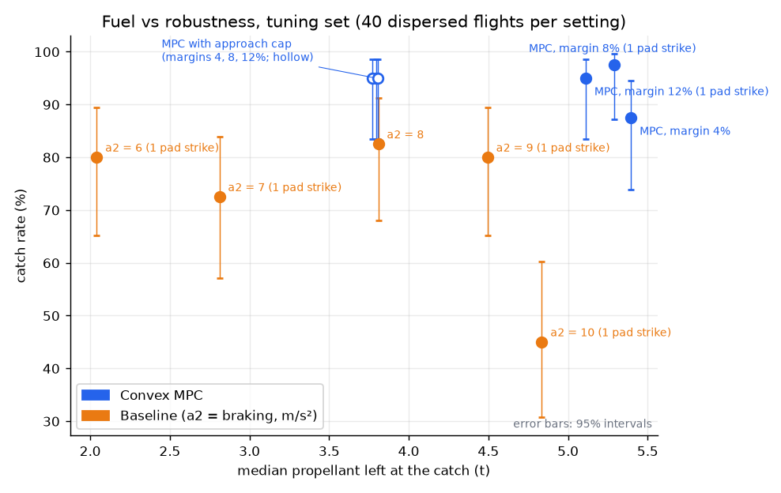
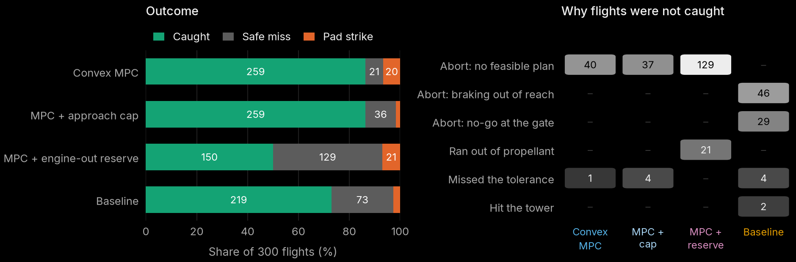
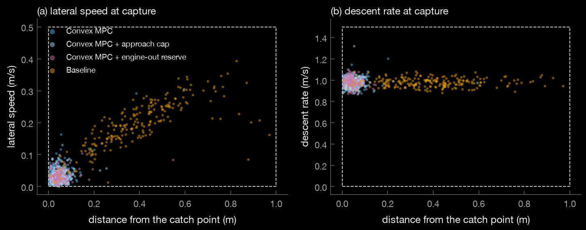
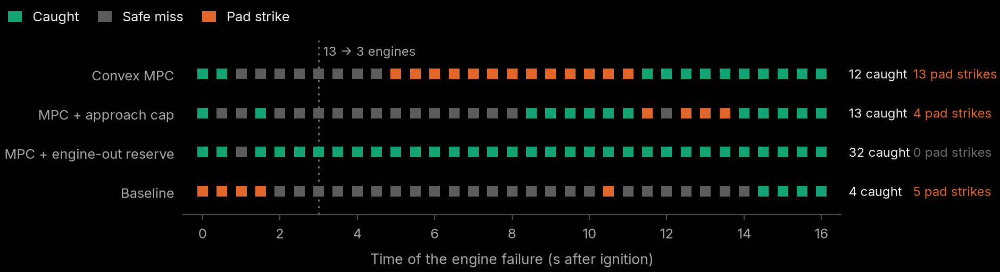
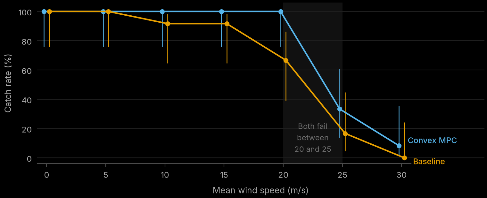
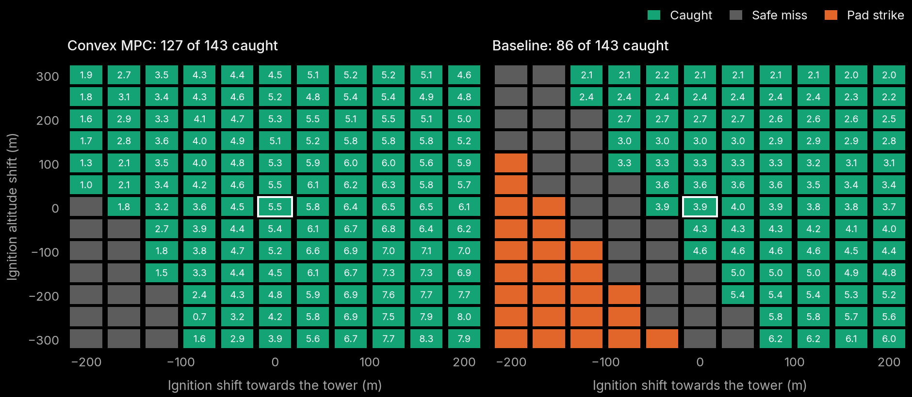
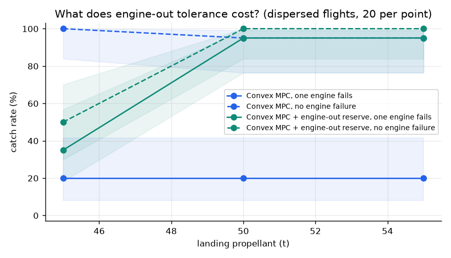

# Catching Super Heavy: fuel-optimal guidance versus a braking heuristic

A simulation study of the last ~16 seconds of a Super Heavy tower catch: a convex,
fuel-optimal model-predictive controller and an engineered braking-profile controller fly
the same dispersed landing burns, with the same sensors, engines, estimator, terminal
descent and abort rules. Every number below comes from code in this repository; all
vehicle data are public estimates, not SpaceX data.

**Summary of findings**

* **The catch happens at the throttle floor.** Three Raptors at 40 % almost exactly hover a
  near-empty booster: it can brake at ~13 m/s² but barely speed its descent up. Over-braking
  near the arms is a trap, which forces a decelerating final descent (§1).
* **Fuel-optimal guidance is more accurate and more robust, and carries more fuel.** Over
  300 dispersed flights with no engine failure, the convex MPC caught 243-244 of 244 against
  the baseline's 217, landing with a median 5.2 t of propellant against 3.9 t (tuned MPC),
  and stopped within 4 cm of the catch point against 38 cm (§5.2). It also catches from a
  far larger range of ignition points (127 of 143 vs 86, no pad strikes vs 25; §5.5) and
  in stronger crosswinds (100 % at 20 m/s vs 67 %; §5.4).
* **Its weak spot is the engine failure it was not designed for.** Braking late saves fuel
  but leaves less room to divert: after a mid-burn engine failure the tuned MPC came down
  near the pad in 20 of 56 failures, against 8 for the baseline. A 10 m/s approach cap cuts
  that to 5 (the fewest of any controller) at the same 86 % overall catch rate, for 1.5 t of
  propellant (§5.2-5.3).
* **Engine-out tolerance is one convex constraint plus ~5 t of propellant.** A braking
  reserve that keeps two engines able to stop the booster at all times survives 32 of 33
  failure times in nominal conditions, and with 50 t instead of 45 t of landing propellant
  19 of 20 failures under full dispersions, with no pad strikes (§5.3, §5.6).
* **The guidance is verified independently**: it matches a shooting solution of the 1-D
  problem (0.03 %) and SciPy SLSQP on the original non-convex problem from three starts
  (0.02 %); the simulator matches the exact rocket equation (§3).
* **Seven failure mechanisms found by tracing flights** (limit-riding, lag against bang-bang
  plans, the throttle floor, estimator/planner mismatch, a planner that disagreed with
  itself, constraints leaking between grid nodes, propellant for the unplanned phase) are
  written up in §6; they are the most transferable part.

## 1. Setup

**Vehicle** (`boostercatch/vehicle.py`). Raptor 2 sea-level thrust 2.256 MN, throttle
40-100 %, Isp 327 s; booster empty mass 275 t, 45 t of landing propellant, 9 m x 71 m.
The landing burn starts on 13 engines and switches to the 3 centre engines at 3 s.

**Scenario.** Ignition at 1,250 m altitude, 280 m offshore and 60 m north of the tower,
falling at 270 m/s with 30 m/s of drift towards the tower. Frame: x points from offshore
towards the tower, z up; the catch point is the booster's centre of mass at capture, 65 m
above the tower base.

**Catch.** The booster's centre of mass must pass the catch height within 1 m of the
catch point, descending at under 1.5 m/s, moving sideways at under 0.5 m/s, with thrust
tilt under 3°. A booster that misses keeps flying (diverting offshore) until it reaches
the ground; it is a *safe miss* if it comes down more than 40 m from the tower, otherwise a
*pad strike*. Touching the tower structure is always a pad strike.

**The throttle floor.** Three Raptors at 40 % give 2.71 MN; a near-empty booster weighs
about 2.75 MN. At minimum throttle the booster almost exactly hovers: it can brake at up
to ~13 m/s² but can accelerate its descent by only a few tenths of a m/s². Over-braking
near the arms is therefore a trap (an early version stalled 12 m above the arms and hovered
until its propellant ran out), and a constant-speed final descent would sit on the floor
with no authority to correct downwards. Both controllers therefore hand over at a
**terminal gate** 12 m above the arms to the same law: a constant 1 m/s² deceleration from
5 m/s to 1 m/s, which keeps thrust ~10 % above the floor.

## 2. The two controllers (`boostercatch/controllers.py`)

**Convex MPC.** Every second (0.5 s after ignition, then every 1 s, frozen in the last
2.5 s before the gate) it solves a minimum-fuel trajectory from the current estimated
state to the gate, then tracks it with a PD correction. The plan respects: thrust in
[40 %, 100 % - margin] of the live engines (13, then 3), thrust tilt ≤ 15° - tilt margin
(≤ 3° in the 2 s before the gate), an offshore half-space until the commit window (6 s
before the gate), a 20° glide-slope cone over the catch point, drag (successive passes,
the first on the previous plan's velocities), the estimated disturbance, and the expected
thrust tail-off at the engine switch. Two optional convex constraints are evaluated as
variants: an **approach cap** (close on the tower at ≤ 10 m/s inside the commit window)
and an **engine-out braking reserve** (in the 3-engine phase, v_z² ≤ v_gate² +
2 a_eo (z - z_gate), where a_eo is the net deceleration with one engine fewer: losing an
engine never leaves the booster unable to stop at the gate). Tuned settings (on a separate
tuning set, §5.1): margin 8 %, tilt margin 2°, neither option. The plan must also arrive
at the gate with the terminal descent's propellant (~3.9 t) still on board.

If no plan exists with the margins, it relaxes them in tiers, then allows a faster gate
arrival (up to 12 m/s, which the terminal descent can absorb); if still nothing exists and
the gate is more than 3 s away, the infeasibility is taken as a certificate that the catch
is lost and it aborts. An engine failure triggers an immediate re-plan with the reduced
engine count.

**Baseline.** Vertical: during the 13-engine phase, the constant acceleration that lands
the booster on a constant-deceleration speed profile at the engine switch; then that
profile (deceleration a2, tuned) down to the gate. Sideways: a braking profile (3 m/s²,
capped at 45 m/s) to a waiting point offshore of the tower, switching to the catch point
when the commit window opens. On an engine failure it rescales a2 to the remaining
braking capability; if the braking needed to reach the gate exceeds 95 % of what the
engines can give, it aborts.

**Shared, so the comparison isolates the guidance:**
* a thrust model (commands through the nominal engine limits and 0.25 s lag) and a
  mass estimate integrated from it;
* an observer that explains the unexplained acceleration as a thrust-effectiveness
  factor k (along the thrust: thrust bias and mass error) plus a residual (across it:
  mostly wind); commands are scaled by 1/k and the residual is fed forward with the drag
  model;
* the terminal descent from the gate, entered one throttle lag early;
* a go/no-go check at the gate (predicted sideways stopping point within 1.5 m), a
  tower keep-out watch, and an offshore divert (up to 30° tilt) after any abort.

## 3. Guidance: lossless convexification (`boostercatch/guidance.py`)

Following Açıkmeşe & Ploen (2007) and Açıkmeşe, Carson & Blackmore (2013): with
u = T/m, σ = Γ/m and z = ln m, the non-convex thrust ring T_min ≤ ‖T‖ ≤ T_max becomes
‖u‖ ≤ σ with σ bounded by Taylor expansions of T_min e^{-z} (second order, below) and
T_max e^{-z} (first order, above) about the lightest reachable mass, and the mass dynamics
become linear: ż = -σ/(Isp g0). The problem is a second-order cone program (CVXPY +
Clarabel, 32 nodes, ~0.1-0.3 s per solve). The relaxation is lossless (‖u‖ = σ at the
optimum); the code rejects any plan that would ask for less than minimum throttle.

The time grid has nodes exactly at every rule boundary (engine switch, commit window,
final alignment). Without this, a constraint checked only at nodes can be violated
between them and the next re-plan, on a different grid, finds the same gate time
infeasible and must slip it, at a cost of ~0.5 t of propellant per half second.

### Validation (`tests/test_guidance.py`, `scripts/validate_guidance.py`)

| check | result |
|---|---|
| lossless gap on the nominal plan (max σ - ‖u‖, relative) | 1.4 x 10⁻⁷ |
| planned thrust inside the real 40-100 % range | every interval |
| vertical descent vs independent bang-bang shooting solution | fuel 16,524.6 vs 16,520.2 kg (0.03 %), flight time 10.261 vs 10.256 s |
| SLSQP on the original non-convex problem, free final time, 3 different starting guesses | all converge to 11.233 s, 18,170.2 kg; convex: 11.221 s, 18,173.3 kg (+0.02 %, the conservative Taylor bounds) |
| plan replayed open loop in the simulator (14 s from 270 m/s) | 4.7 m, 0.40 m/s, 40 kg off |
| simulator integrator vs exact rocket-equation solution | < 1 mm, < 1 mm/s |

A note on the SLSQP check: at a *fixed* flight time, SLSQP from a smooth start converges
in 3 iterations to a smooth thrust ramp with the same fuel as the convex max-min-max
profile (19,049.9 vs 19,048.0 kg). The fuel is nearly independent of the thrust profile at
fixed time, because the boundary conditions fix the vertical impulse; the real fuel lever is
the flight time (gravity loss). The free-final-time comparison above is the discriminating
test.

## 4. Simulator and dispersions (`boostercatch/sim.py`, `boostercatch/montecarlo.py`)

3-DoF point mass, RK4 at 50 Hz. Thrust direction stands in for attitude (no rotational
dynamics). Truth model and Monte Carlo dispersions (1σ unless stated):

| quantity | model / dispersion |
|---|---|
| drag | crossflow model: vertical airflow on the 64 m² base (Cd 0.9), horizontal on the 639 m² side (Cd 0.7); Cd x U(0.8, 1.2) |
| wind | mean U(0, 15) m/s, random direction; gusts: Ornstein-Uhlenbeck, σ = 0.5 + 0.15 x mean, 3 s correlation |
| engines | thrust bias N(0, 2 %) clipped at ±5 %, Isp x N(1, 0.5 %), first-order lag 0.25 s |
| mass | dry mass x N(1, 2 %) |
| ignition state | position 20 m horizontal / 15 m vertical, velocity 3 m/s horizontal / 5 m/s vertical |
| engine failure | probability 0.2, at a uniform time in [0, 15] s; one engine lost for the rest of the burn |
| navigation | white noise 0.3 m, 0.1 m/s |

A 15 m/s crosswind pushes the booster sideways at 0.22 m/s²; the terminal descent's tilt
limit (2.7°) allows about 0.5 m/s² of correction, which is why wind is a real limit here.

## 5. Results

### 5.1 Tuning (`results/mc_tune_v4.jsonl`, 40 dispersed flights, seed 99)

Every setting flew the same 40 flights (3 of which drew an engine failure). The rule, fixed
before looking: highest catch rate, ties broken by propellant left.

| setting | caught (all 40) | caught, no engine failure | median propellant left | pad strikes |
|---|---|---|---|---|
| **MPC, margin 8 %** | **39 (97.5 %)** | 37/37 | **5.3 t** | 1 |
| MPC, margin 12 % | 38 | 37/37 | 5.1 t | 1 |
| MPC, margin 4 % | 35 | 33/37 | 5.4 t | 0 |
| MPC + approach cap, margins 4/8/12 % | 38 | 37/37 | 3.8 t | 0-1 |
| **baseline a2 = 8 m/s²** | **33 (82.5 %)** | 33/37 | **3.8 t** | 0 |
| baseline a2 = 9 | 32 | 31/37 | 4.5 t | 1 |
| baseline a2 = 6 | 32 | 32/37 | 2.0 t | 1 |
| baseline a2 = 7 | 29 | 29/37 | 2.8 t | 1 |
| baseline a2 = 10 | 18 | 17/37 | 4.8 t | 1 |

The two controller families trade fuel for robustness differently. The baseline's knob is
its braking level: brake gently and it lands with 2 t; brake hard and it has fuel to spare
but stops passing the go/no-go check at the gate (a2 = 10: 45 %). The MPC sits above and to
the right of the whole baseline curve (figure `tradeoff.png`).

### 5.2 Main Monte Carlo (`results/mc_random.jsonl`, 300 dispersed flights, seed 2026)

The full dispersion model of §4; 56 of the 300 flights drew an engine failure. Every
controller flew the same 300 flights. 95 % Wilson intervals.

| controller | caught | 95 % CI | safe miss | pad strike | median propellant left (5th pct) |
|---|---|---|---|---|---|
| **MPC (tuned)** | **259 (86.3 %)** | 82.0-89.8 | 21 | 20 | **5.2 t** (3.2) |
| **MPC + approach cap** | **259 (86.3 %)** | 82.0-89.8 | 36 | **5** | 3.7 t (1.9) |
| MPC + engine-out reserve | 150 (50.0 %) | 44.4-55.6 | 129 | 21 | 1.1 t (0.3) |
| baseline | 219 (73.0 %) | 67.7-77.7 | 73 | 8 | 3.9 t (2.7) |

Split by whether an engine failed:

| controller | no engine failure (244) | engine failure (56): caught / safe / strike |
|---|---|---|
| MPC (tuned) | 243 caught, 0 strikes | 16 / 20 / 20 |
| MPC + approach cap | **244** caught, 0 strikes | 15 / 36 / **5** |
| MPC + engine-out reserve | 121 caught, 17 strikes | 29 / 23 / 4 |
| baseline | 217 caught, 0 strikes | 2 / 46 / 8 |

Precision at the arms (caught flights): distance from the catch point median 4.2 cm /
95th percentile 9.5 cm for every MPC variant, against 38 cm / 76 cm for the baseline;
sideways speed 95th percentile 0.08 vs 0.31 m/s.

What this says:

* **Without engine failures the MPC is close to perfect**: 243-244 of 244 caught, versus
  217 for the baseline, with 1.3 t more propellant (tuned MPC) and 9x tighter capture.
  The baseline's misses are aborts: braking out of reach after a low or slow start (46 of
  its 81 misses across all flights) and no-go at the gate (29).
* **Engine failures are where the variants separate.** The tuned MPC saves 16 of 56
  boosters (the baseline saves 2), but 20 of its aborts come down near the pad: its
  late-braking, fuel-optimal profile leaves less room to divert (§5.3). The approach cap
  costs 1.5 t of propellant and turns 15 of those pad strikes into safe misses, with the
  same overall catch rate.
* **The tuning rule missed this.** "Highest catch rate, then fuel" picked the uncapped MPC
  on a tuning set with only 3 engine failures, where the pad-strike difference was 1 vs 0.
  With 56 failures the difference is 20 vs 5. A rule that weights pad safety (the outcome
  that matters most for a tower catch) picks the **capped MPC**: the same 86 % catch rate
  as the tuned MPC, the fewest pad strikes of all four controllers, at the baseline's
  propellant margin.
* **The engine-out reserve does not survive real dispersions at 45 t.** In calm, nominal
  conditions it survives 32 of 33 failure times (§5.3); here, with ~1 t of slack, it either
  correctly refuses catches it cannot afford (129 safe aborts) or, 21 times, runs dry in the
  terminal descent: its propellant estimate drifts by ~1 t with a 2 % thrust bias, more than
  its slack. §5.6 asks how much propellant would make it robust.

### 5.3 Engine failure timing (`results/mc_engineout.jsonl`, calm air, nominal vehicle)

One engine fails at a single moment between ignition and 16 s (33 flights per controller):

| controller | caught | safe miss | pad strike | propellant left when caught |
|---|---|---|---|---|
| **MPC + engine-out reserve** | **32** | 1 | **0** | 0.5 t |
| MPC + approach cap | 13 | 16 | 4 | 2.7 t |
| MPC (tuned) | 12 | 8 | 13 | 5.5 t |
| baseline | 4 | 24 | 5 | 3.9 t |

* The **tuned MPC** re-plans with the reduced engine count and saves the booster when the
  failure comes very early (13 engines can absorb it) or late (after 11.5 s, little braking
  is left to do). In between, it correctly finds that no catch exists and aborts, but it
  comes down near the pad in 13 of 33 cases. The reason is its fuel efficiency: it brakes
  late, so when an engine fails mid-burn it is lower and faster than the baseline at the
  same moment (at 6 s: 72 m lower) and has less time to steer clear.
* The **baseline** brakes earlier, so its aborts usually come down clear, but it almost
  never saves the booster (4 of 33).
* The **engine-out braking reserve** (one convex constraint) changes the picture: the
  booster survives the loss of an engine at any moment except two (1.0 and 2.0 s, safe
  misses), with no pad strikes. It does this by braking harder while 13 engines are
  available and descending more slowly on 3, so that 2 engines could always still stop it.
  The cost is about 5 t of the 45 t landing propellant: it lands with ~0.5 t instead of
  ~5.5 t. Full single-engine-out tolerance fits in this propellant budget, but only just.

### 5.4 Crosswind (`results/mc_wind.jsonl`, 12 flights per speed, no engine failures)

| mean wind (m/s) | 0 | 5 | 10 | 15 | 20 | 25 | 30 |
|---|---|---|---|---|---|---|---|
| MPC caught | 100 % | 100 % | 100 % | 100 % | 100 % | 33 % | 8 % |
| baseline caught | 100 % | 100 % | 92 % | 92 % | 67 % | 17 % | 0 % |

Both collapse between 20 and 25 m/s. At 25 m/s the wind pushes the 71 m booster sideways at
~0.6 m/s² plus gusts, more than the terminal descent's 2.7° tilt can correct (~0.5 m/s²):
that limit is set by the catch geometry, not by either guidance law.

### 5.5 Capture basin (`results/mc_basin.jsonl`, calm air, nominal vehicle)

The ignition point is shifted by up to ±200 m towards/away from the tower and ±300 m in
altitude (143 points):

| controller | caught | safe miss | pad strike |
|---|---|---|---|
| MPC | **127** | 16 | **0** |
| baseline | 86 | 32 | 25 |

The baseline's fixed braking profile cannot absorb a late (low) or far-offshore ignition:
it discovers the problem at the gate, where an abort is too late to clear the pad. The MPC
re-plans from wherever it is; where no catch exists its planner says so seconds earlier
(including when the remaining propellant could not cover the terminal descent) and the
booster diverts offshore.

### 5.6 What engine-out tolerance costs (`results/mc_eoprop.jsonl`)

The same 40 dispersed flights (full dispersion model; 20 with an engine failure at a random
time, 20 without) flown with 45, 50 and 55 t of landing propellant:

| landing propellant | reserve MPC, no failure | reserve MPC, one engine fails | tuned MPC, one engine fails |
|---|---|---|---|
| 45 t | 10/20 | 7/20 (3 pad strikes) | 4/20 (7 pad strikes) |
| **50 t** | **20/20** | **19/20, no pad strikes** | 4/20 (6 pad strikes) |
| 55 t | 20/20 | 19/20, no pad strikes | 4/20 (6 pad strikes) |

About **5 t more landing propellant (+11 %)** makes single-engine-out tolerance robust to the
dispersions: 19 of 20 engine failures survived with no pad strikes. Extra propellant alone
does nothing for the tuned MPC (4/20 at every level): it is the convex braking-reserve
constraint that converts propellant into engine-out safety, by spending it on braking
early, while 13 engines are available. (20 flights per point: 19/20 has a 95 % interval of
roughly 76-99 %.)

## 6. What building it taught me

Each of these was a failure in an earlier version, found by tracing individual flights.
They are properties of the problem, not just bugs, and they are the most transferable
part of the work.

1. **Fuel-optimal plans ride every limit at once.** The optimum brakes as late as possible
   at full thrust *and* full tilt (while cancelling sideways speed). A thrust margin alone
   is not enough: the plan still sat on the tilt limit, and any sideways error made it
   infeasible. Margins on both (8 %, 2°) fixed it.
2. **Actuator lag against bang-bang plans.** The engines' 0.25 s response, against a
   max-min-max thrust plan, lost 1-3 m/s of braking at every switch, always in the
   dangerous direction. Commanding the plan one lag early (lead compensation), modelling
   the engine-switch tail-off, and entering the terminal descent one lag early fixed it.
3. **The throttle floor makes over-braking a trap.** With three engines at minimum
   throttle the booster nearly hovers. Clipping an oversized sideways command by rotating
   the thrust vector turned the excess into braking and stalled the booster 12 m above the
   arms until it ran dry. Trim the sideways part instead.
4. **The estimator must match what the planner needs.** Explaining a thrust shortfall as
   extra mass gives the right accelerations but corrupts the planner's propellant budget
   (by ~10 t), so it falsely declared catches impossible. The planner now gets the engine
   thrust scaled by the estimated effectiveness.
5. **A planner must agree with itself.** Re-planning from a point on its own plan, with the
   same rules, said "infeasible". The cause: drag entered by successive passes and the first
   pass ignored it; drag supplies up to 8 m/s² of braking, so the drag-free pass failed
   before drag was ever added. This one check (re-plan from your own plan) removed most of
   the closed-loop fuel loss (~2 t) and most false aborts.
6. **Constraints checked at nodes leak between them.** Time-indexed rules (offshore until the
   commit window) checked only at grid points let plans cross between points; the next plan,
   on another grid, found the same timing infeasible and slipped (~0.5 t per half second). A
   grid node on every rule boundary fixed it.
7. **Infeasibility is a useful certificate only if the model is honest.** Aborting when the
   convex planner finds no solution is powerful (it decides seconds earlier than a heuristic
   could), but every modelling gap above showed up first as a false abort. And the plan must
   budget the propellant for the part it does not plan (the terminal descent), or it will
   "succeed" and run dry over the arms.

## 7. Limitations

* **Point mass.** Thrust direction stands in for attitude: no rotational dynamics, engine
  gimbal limits, grid fins, slosh, flex or aerodynamic moments. Tilt limits and lag are the
  only proxies. The tower-strike check uses the centre of mass plus the booster's radius,
  which is consistent with a body held near upright while the engines gimbal (up to ~15°)
  to tilt the thrust. The 3D replay draws it that way: the body leans about a third of the
  way into the thrust and the flames gimbal the rest. (An earlier version of the replay
  rotated the whole 71 m body to the full thrust tilt, which swung the engine end up to
  15 m into the tower in the drawing although the simulated booster never came within
  1.75 m of it.)
* **Public estimates.** Vehicle mass, propellant, drag coefficients, tower geometry, catch
  height and tolerances are estimates. Absolute catch rates should not be read as
  predictions for the real vehicle; the comparisons, mechanisms and trade-offs are the result.
* **Atmosphere and wind** are simple (constant density, uniform mean wind with Ornstein-
  Uhlenbeck gusts; no shear or tower wake).
* **Engines** are a single total thrust with a first-order lag; a real engine-out would also
  bring a thrust transient and a moment that the point mass cannot show. Engine-out recovery
  assumes the failure is detected instantly.
* **Solve time.** ~0.1-0.3 s per plan in Python/CVXPY; flight software would use an embedded
  solver (G-FOLD-style implementations solve comparable problems in well under a second on
  flight hardware).
* **Sample sizes.** 40 flights per tuning setting, 12 per wind speed: intervals are wide
  and reported.

## 8. References

* B. Açıkmeşe and S. R. Ploen, "Convex programming approach to powered descent guidance for
  Mars landing", *J. Guidance, Control, and Dynamics* 30(5), 2007.
* B. Açıkmeşe, J. M. Carson III and L. Blackmore, "Lossless convexification of nonconvex
  control bound and pointing constraints of the soft landing optimal control problem",
  *IEEE Trans. Control Systems Technology* 21(6), 2013.
* L. Blackmore, "Autonomous precision landing of space rockets", *The Bridge* 46(4), 2016.
* Public vehicle figures: Wikipedia, "SpaceX Raptor" and "SpaceX Super Heavy" (accessed 2026).

Reproduce everything: [docs/REPRODUCE.md](docs/REPRODUCE.md).
