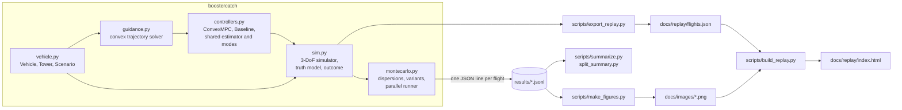

# Code architecture

How the code is organised, how a simulated flight runs from start to finish, and how to
extend it. For the method and results see [REPORT.md](../REPORT.md); for file formats see
[DATA.md](DATA.md).

- [Overview](#overview)
- [Conventions](#conventions)
- [vehicle.py](#vehiclepy)
- [guidance.py](#guidancepy)
- [controllers.py](#controllerspy)
- [sim.py](#simpy)
- [montecarlo.py](#montecarlopy)
- [Scripts](#scripts)
- [Tests](#tests)
- [Design decisions](#design-decisions)
- [Extending the code](#extending-the-code)

## Overview



The library is about 1,200 lines of Python in five modules with a strict dependency order:
`vehicle` → `guidance` → `controllers` → `sim` → `montecarlo`. Nothing in the library
writes files except `montecarlo.run_jobs`. Everything under `scripts/` is a thin command-line
layer over the library.

One closed-loop step, every 0.02 s of simulated time:

```mermaid
sequenceDiagram
  participant Sim as sim.simulate
  participant Ctl as controller.command
  participant Obs as _Base._estimate
  participant Plan as guidance (MPC only)
  Sim->>Sim: engine count (13, then 3; minus one after a failure)
  Sim->>Ctl: t, noisy position and velocity, engine count
  Ctl->>Obs: update mass estimate, thrust effectiveness k, residual acceleration
  alt aborted
    Ctl-->>Sim: divert command (offshore, up to 30° tilt)
  else at or below the gate
    Ctl->>Ctl: go/no-go check, tower keep-out check
    Ctl-->>Sim: terminal-descent command
  else approach
    Ctl->>Plan: re-plan if due (every 1 s; immediately after an engine failure)
    Ctl-->>Sim: tracking command (MPC) or braking-profile command (baseline)
  end
  Sim->>Sim: clip to engine range and 30° tilt, apply thrust bias and 0.25 s lag
  Sim->>Sim: gusts, drag, RK4 step, check tower, ground, propellant, catch height
```

## Conventions

* **Frame.** Origin at the tower base. `x` points from offshore towards the tower (east),
  `y` north, `z` up. The tower's front face is the plane `x = 9 m`; the catch point is
  `(0, 0, 65)`, the booster's centre of mass at capture.
* **Units.** SI throughout inside the library: metres, seconds, kilograms, newtons. Result
  files report propellant in kilograms; figures and the replay convert to tonnes and meganewtons.
* **Time.** `t = 0` is landing-burn ignition. The engine switch is at `Scenario.switch_time = 3 s`.
* **Thrust commands.** Controllers return a thrust vector in newtons. The simulator, not the
  controller, enforces the physical limits.

## vehicle.py

Three frozen dataclasses hold every physical parameter, so a Monte Carlo variant or a
sensitivity study changes them in one place (`dataclasses.replace`).

| Class | Holds | Notable members |
|---|---|---|
| `Vehicle` | engine thrust and throttle range, Isp, dry mass, landing propellant, size, drag coefficients, tilt limits | `thrust_bounds(n)`, `alpha` (kg per N·s), `wet_mass`, `area`, `side_area` |
| `Tower` | catch point, offshore standoff and commit window, approach-speed cap, terminal gate and descent law, capture tolerances | `gate_speed` (5 m/s, derived), `gate_point`, `terminal_duration` |
| `Scenario` | ignition state, engine counts, engine-switch time | `with_(**kw)` |

`SUPER_HEAVY`, `TOWER` and `NOMINAL` are the default instances used everywhere.

## guidance.py

The convex trajectory optimiser. It knows nothing about estimation or closed-loop control: it
takes a state and returns a `Plan` (or `None` if the problem is infeasible).

| Function | Purpose |
|---|---|
| `solve_fixed(veh, tower, r0, v0, m0, tf, …)` | Minimum-fuel trajectory to the gate in exactly `tf` seconds: the SOCP of [REPORT.md §3](../REPORT.md#3-guidance-lossless-convexification-boostercatchguidancepy). Returns a `Plan` or `None`. |
| `solve_with_drag(…, passes, v_guess)` | Drag by successive passes: evaluate drag on a velocity guess (the previous plan, or a straight line to the gate velocity), solve, repeat. |
| `solve_earliest(…)` | The earliest feasible flight time, by bisection on feasibility. Propellant rises monotonically with flight time inside the feasible window, so this is the fuel optimum. Used for the first plan. |
| `solve_free_time(…)` | Golden-section search on flight time for the minimum-fuel plan. Used by the verification, not by the controller. |
| `time_grid(tf, N, breaks)` | Node times with a node exactly on every rule boundary (engine switch, commit window, final alignment). |
| `drag_accel(v, m, wind, veh)` | Crossflow drag: vertical airflow on the 64 m² base, horizontal on the 639 m² side. Shared with the simulator's truth model (which scales it by the dispersed drag coefficient). |
| `terminal_reserve(veh, tower)` | Propellant the terminal descent needs (plus 5%), which the plan must deliver to the gate. |

Keyword options of `solve_fixed` that the controller uses:

| Option | Effect |
|---|---|
| `margin` | Keep maximum planned thrust this fraction below the real maximum (8% by default). Not applied at minimum thrust. |
| `tilt_margin_deg` | Shrink the tilt cone by this much (2° with the 8% margin). |
| `elapsed`, `total_tf` | Keep the original phase timing (engine switch, commit window) as the horizon shrinks. |
| `extra_accel` | Known disturbance acceleration added to the dynamics (the observer's residual). |
| `gate_speed_max` | Allow a faster gate arrival, up to this speed (recovery mode). |
| `approach_cap` | Close on the tower at ≤ `Tower.approach_speed_max` inside the commit window. |
| `eo_reserve` | Engine-out braking reserve in the 3-engine phase. |
| `switch_lag` | Model the extra braking impulse from the 13-engine tail-off at the switch. |

`Plan` holds node times `t`, positions `r`, velocities `v`, masses `m`, per-interval thrust
and thrust acceleration, the slack `sigma`, total `fuel`, `tf`, solver status and the
measured `lossless_gap`.

## controllers.py

Two controllers on one base class. The base class holds everything the two share, so the
comparison isolates the guidance law.

### `_Base` (shared)

| Method | Role |
|---|---|
| `reset(veh, tower, scen)` | Clear all state before a flight. |
| `command(t, r, v, n_eng)` | The entry point the simulator calls. Runs the estimator, then picks the mode: divert after an abort, terminal descent below the gate (with the go/no-go and keep-out checks), otherwise the subclass's `approach_command`, tilt-limited. |
| `_estimate(t, v_meas)` | Mass estimate from the modelled thrust; observer for the thrust-effectiveness factor `k_hat` (error along the thrust) and residual acceleration `d_hat` (error across it). The nominal drag model sits inside the observer's prediction. |
| `_output(cmd, n_eng)` | Advance the controller's own model of what the engines are doing (nominal limits, nominal lag). |
| `terminal_command(r, v)` | Shared terminal descent: follow `v(h) = −√(v_f² + 2·a·h)` from the gate to the arms, centre over the catch point within a 2.7° tilt limit. |
| `gate_check`, `keep_out_check` | Predicted lateral stopping point inside the tolerance, and at least 1 m from the tower face. |
| `divert_command(r, v, n_eng)` | Steer offshore at up to 30° tilt while holding an 8 m/s descent. |
| `_enter_terminal(t, h, vz)` | Switch modes one throttle lag before the gate. |
| `notify_engine_out(t)`, `abort(t, reason)` | Events from the simulator and from the controller itself. |

`limit_tilt(u, max_deg)` fits a command into a tilt cone by trimming the horizontal part
(rotating the whole vector instead would turn excess sideways demand into braking, which
stalls a near-empty booster above the arms).

### `ConvexMPC`

Constructor options: `margin` (0.08), `tilt_margin` (2°), `approach_cap` (False),
`eo_reserve` (False), `replan_every` (1 s), `first_replan` (0.5 s), `freeze_last` (2.5 s),
`n_nodes` (32), tracking gains `kp`, `kd`.

* The first plan uses `solve_earliest`. Later re-plans keep the gate time if they can, then try
  later gate times (`shifts`), then smaller margins; then a recovery plan with a faster gate
  arrival. If nothing is feasible more than `abort_horizon` (3 s) before the gate, it aborts.
* Between re-plans it tracks the plan with a PD correction. It commands the plan one
  throttle lag early (lead compensation), because the plans switch thrust abruptly.
* The planner sees the engines scaled by the estimated effectiveness
  (`planning_vehicle`), not a scaled mass, so its propellant budget stays correct.
* Diagnostic counters: `n_solves`, `failed_replans`, `recoveries`, `fail_times`.

### `Baseline`

Constructor options: `a2` (8 m/s², the braking level), `kv`, `a_lat` (3 m/s²),
`v_lat_max` (45 m/s), `k_pos`, `k_vel`. `v_ref(h)` is the constant-deceleration speed
profile. During the 13-engine phase, a bisection finds the constant acceleration that lands
the booster on that profile at the switch. After an engine failure, `a2` is rescaled to the
remaining braking capability.

## sim.py

`simulate(controller, veh, tower, scen, disp=Dispersion(), t_max=60, record_every=5)` flies
one landing burn and returns a `Result`.

**Truth model.** RK4 at 50 Hz (`DT = 0.02`). Thrust is the command clipped to the live
engines' range and a 30° tilt, scaled by the thrust bias and passed through a first-order
lag. Mass flow uses the dispersed Isp. Drag is relative to the mean wind plus
Ornstein–Uhlenbeck gusts. The controller sees position and velocity with white noise.

**Termination and classification**, checked every step:

| Condition | `reason` | Outcome |
|---|---|---|
| Centre of mass crosses the catch height within all tolerances, no abort | `caught` | caught |
| Crosses it outside tolerance | `missed: …` (which tolerances), then keeps flying | safe miss or pad strike, by impact point |
| Climbing above the arms (braked too hard) | `stalled above the arms` | by impact point |
| Propellant exhausted | `out of propellant` | by ballistic impact point |
| Booster footprint enters the tower volume | `hit the tower` | pad strike |
| Base reaches the ground | `hit the ground` (or the earlier miss reason) | safe miss if more than `PAD_RADIUS` = 40 m from the catch point, else pad strike |

If the controller aborted, the reason is prefixed `aborted (…)`.

**`Dispersion` fields** (all default to the nominal flight): `dr0`, `dv0` (ignition-state
offsets), `wind_mean` (m/s, horizontal), `gust_sigma`, `cd_scale`, `thrust_bias`
(fraction), `isp_scale`, `dry_mass_scale`, `engine_out_time` (s or `None`),
`nav_sigma_r`, `nav_sigma_v`, `tau_lag`, `seed`.

**`Result` fields:** `caught`, `reason`, time histories `t`, `r`, `v`, `m`, `thrust`,
`n_engines` (every `record_every` steps), `capture` (`lateral_error`, `vz`, `vh`,
`tilt_deg`, `propellant_left`, `time` at the catch-height crossing), `pad_safe`, `impact`
(x, y), `abort_reason`, `abort_time`.

Also: `tower_hit(r)` (the tower volume test) and `ballistic_impact(r, v)`.

## montecarlo.py

* `sample(rng, wind_max=15, p_engine_out=0.2, seed)` draws one `Dispersion` from the model in
  [REPORT.md §4](../REPORT.md#4-simulator-and-dispersions-boostercatchsimpy-boostercatchmontecarlopy).
* `make_controller(spec)` builds a controller from a string: `"mpc"`, `"baseline"`, or a
  variant such as `"mpc[margin=0.12,approach_cap=1]"` or `"baseline[a2=9]"`. Boolean options
  (`approach_cap`, `eo_reserve`) take 0/1; everything else is a float constructor argument.
  On the command line, separate options with `;` (`--controllers "mpc[margin=0.04;approach_cap=0]"`).
* `random_campaign(n, seed, controllers)` builds jobs where every controller flies the same
  `n` dispersed flights.
* `run_case(job)` flies one job and flattens the `Result` into a dictionary (see
  [DATA.md](DATA.md)). An exception inside a controller is recorded as a failed flight rather
  than stopping the campaign.
* `run_jobs(jobs, out_path, workers)` runs jobs in a process pool and appends one JSON line per
  flight. It skips `(controller, case_id)` pairs already in the file, so campaigns resume after
  an interruption.

## Scripts

| Script | Purpose |
|---|---|
| `run_mc.py` | Run a campaign: `pilot`, `tune`, `random`, `engineout`, `basin`, `wind`, `eoprop`. Options: `--controllers`, `--n`, `--workers`, `--tag`. |
| `run_all.sh` | The four evaluation campaigns back to back, through the thermal guard. |
| `summarize.py` | Outcome table per controller with Wilson intervals, miss reasons, propellant and precision. |
| `split_summary.py` | The same, split by whether an engine failed. |
| `validate_guidance.py` | The verification numbers (writes `results/validation.json`). |
| `fuel_ablation.py` | Nominal-flight propellant for each robustness feature (writes `results/fuel_ablation.json`). |
| `make_figures.py` | Every figure in `docs/images/`, from the results files. |
| `export_replay.py` | Fly the six showcase scenarios and write `docs/replay/flights.json`. |
| `build_replay.py` | Assemble `docs/replay/index.html` from the template, the report body, the flights and the figures. |
| `check_replay.py`, `check_camera.py` | Headless-browser checks of the replay page (needs `requirements-dev.txt`). |
| `record_media.py` | Record the README GIF and still from the replay. |
| `debug_flight.py`, `replan_log.py`, `probe_replan.py`, `rerun_cases.py`, `drop_rows.py` | Debugging tools; see [REPRODUCE.md](REPRODUCE.md#debugging-tools). |

## Tests

`python -m pytest tests/ -q` runs 14 tests in one to two minutes.

| Test | Checks |
|---|---|
| `test_nominal_plan_is_lossless_and_within_engine_limits` | ‖u‖ = σ at every node; planned thrust inside the true 40–100% range |
| `test_vertical_descent_matches_bang_bang_shooting_solution` | 1-D convex optimum against an independent shooting solution of the known min–max structure |
| `test_convex_solution_matches_nonconvex_nlp` | SciPy SLSQP on the original non-convex problem, free flight time, three starting guesses |
| `test_plan_dynamics_agree_with_simulator` | A plan replayed open loop in the simulator stays close to its own prediction |
| `test_drag_model_crossflow` | Drag acts on the right areas in the right directions |
| `test_limit_tilt_keeps_vertical_component` | Tilt limiting trims the horizontal part only |
| `test_integrator_matches_rocket_equation` | RK4 against the exact constant-thrust rocket-equation solution |
| `test_ballistic_impact_and_tower_geometry` | Impact prediction and the tower volume |
| `test_estimator_recovers_thrust_effectiveness` | The observer finds a thrust bias |
| `test_nominal_flight_is_caught` | Both controllers catch the nominal flight |
| `test_late_engine_failure_diverts_clear_of_the_pad` | A late failure leads to an abort that comes down clear of the pad |

(Some tests are parametrised, so the total count is higher than the number of functions.)

## Design decisions

* **One shared stack, two guidance laws.** Estimation, terminal descent, abort and divert
  logic live in `_Base`, so differences in outcome come from the guidance law.
* **A terminal gate.** The convex plan ends 12 m above the catch point, and a shared,
  deliberately simple law flies the last metres. Near-empty, three engines at minimum throttle
  almost exactly hover the booster, so the final descent must keep decelerating to keep
  control authority in both directions.
* **Infeasibility as an abort signal.** The MPC aborts when no plan exists more than 3 s before
  the gate. This only works because the plan models everything that matters to feasibility:
  drag, the engine-switch tail-off, the observer's disturbance, the terminal descent's
  propellant.
* **Grid nodes on rule boundaries.** Time-indexed constraints are checked only at nodes, so a
  node sits exactly on each boundary; otherwise plans leak across them and the next re-plan,
  on a different grid, finds the same timing infeasible.
* **Lead compensation.** Fuel-optimal plans switch thrust abruptly; commanding the plan one
  engine lag early delivers the planned impulse.
* **Results as JSON lines.** One self-describing line per flight, appended as flights finish:
  resumable, greppable, and analysable without the simulator.

## Extending the code

**A new controller.** Subclass `_Base` and implement `approach_command(t, r, v, n_eng)`,
returning a thrust vector in newtons (use `self.m_eff * acceleration`). Use `self.abort(t,
reason)` to give up; the shared divert takes over. Register it in
`montecarlo.CONTROLLERS` to use it from `run_mc.py`:

```python
from boostercatch.controllers import _Base
import numpy as np

class GravityTurn(_Base):
    name = "Gravity turn"

    def approach_command(self, t, r, v, n_eng):
        h = r[2] - self.tower.catch_point[2]
        a_brake = max(v[2] ** 2 / (2 * max(h - self.tower.gate_height, 1.0)), 0.0)
        return self.m_eff * np.array([0.0, 0.0, 9.80665 + a_brake]) - self.m_eff * self.accel_ff(v)

res = sim.simulate(GravityTurn(), SUPER_HEAVY, TOWER, NOMINAL)
print(res.reason, res.pad_safe)
# aborted (no-go at the gate); missed: ...  True
```

This toy controller ignores sideways motion, so it reaches the gate off-centre; the shared
go/no-go check aborts the catch and the shared divert brings it down clear of the pad. That
safety net applies to any controller you add.

**A new disturbance.** Add a field to `sim.Dispersion` (default = no effect), use it in the
truth model inside `simulate`, and draw it in `montecarlo.sample`. Controllers must not read
it.

**A new campaign.** Write a `*_jobs(ctls)` function in `scripts/run_mc.py` that returns
`(controller spec, asdict(Dispersion), tags)` tuples with a unique `case_id` per controller,
and add it to the `campaign` choices. Extra tags are copied into every result line.

**Different vehicle numbers.** Pass a modified vehicle, for example
`replace(SUPER_HEAVY, landing_propellant=50e3)`, to `simulate`. For campaigns, `run_case`
honours a `landing_propellant` tag.
